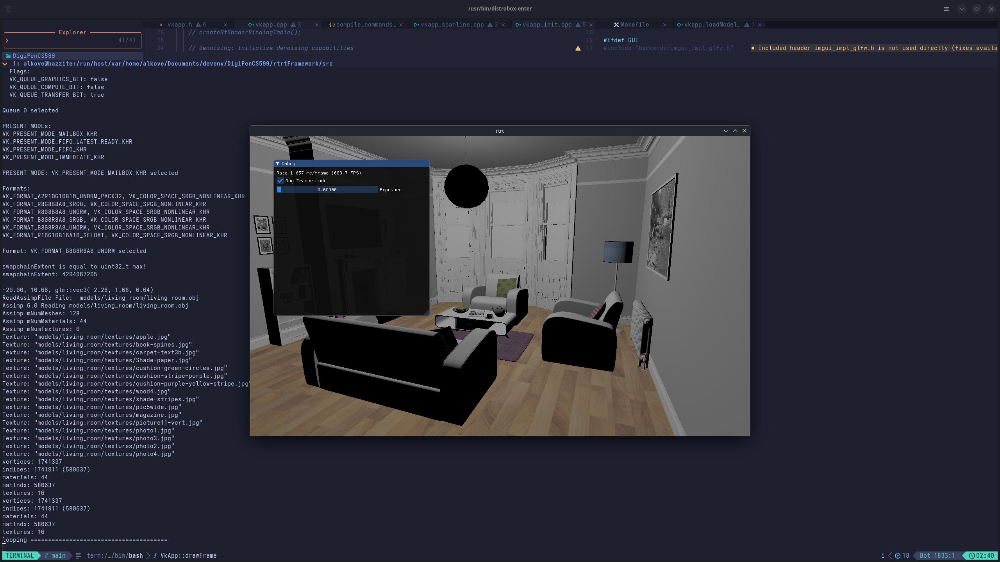

# Project 2 Scanline Algorithm

## Screenshot

## Recording

(Video may not render on all markdown viewers. I use VSCode's markdown preview
to render `.md` documents, which supports this.)

<video width="1280" height="720" controls>
  <source src="media/scanline.mp4" type="video/mp4">
</video>

## Notes

- The following text in the `2-scanline.odt` file has a mistake:

    > 3\. Attach the descriptor set layout to the post process pipeline  
    > &nbsp;&nbsp;&nbsp;&nbsp;&nbsp;Change two lines in **createPostPipeline** (in _**vkapp_postPipeline.cpp**_) from

    The file name should be `vkapp_postProcess.cpp`.
- The `aiString` class in Assimp has a fun interaction where if we use the
headers provided in the lib folder (which are 32-bit), but link a `.so`
library in 64-bit format, the first 4 characters of the string are lost!

    All my textures were under path `/models/ures/`!
