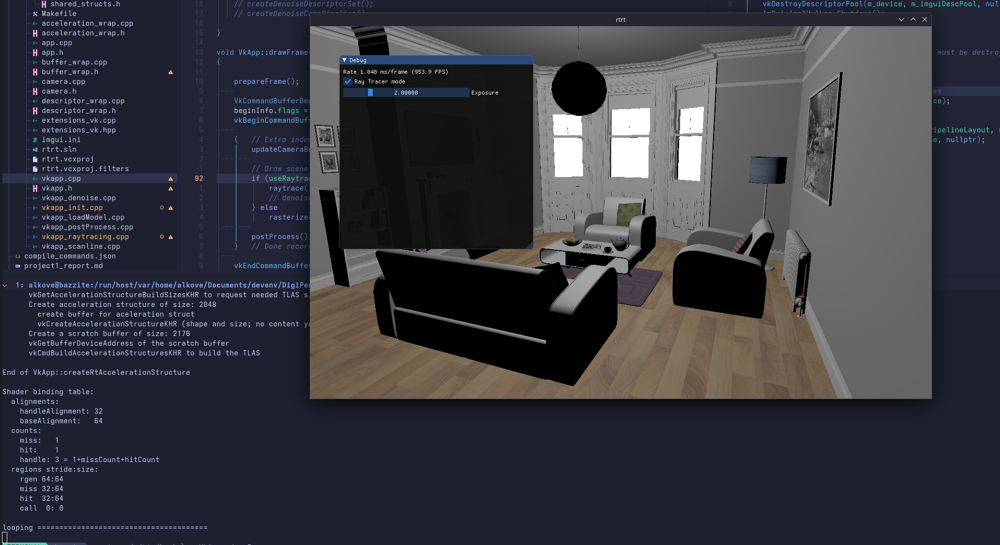

# Project 3: Ray Casting

## Screenshot

## Recording

(Video may not render on all markdown viewers. I use VSCode's markdown preview
to render `.md` documents, which supports this.)

<video width="1280" height="720" controls>
  <source src="media/rayCasting.mp4" type="video/mp4">
</video>

## Notes

- Destroying `m_rtBuilder` only in the `initRayTracing()` call leads to
validation errors on exit, so I added that call to the destroy all resources
section.
  - I'm not entirely sure why this was recommended at this location. I can't
  remember what was explained in class, but this hasn't even been used yet.
  - Since nothing was created yet, running this here just does nothing:
  `for(auto& blas : m_blas)`
  - The first acceleration structure is called under
  `createRtAccelerationStructure()`, which is after this function.
