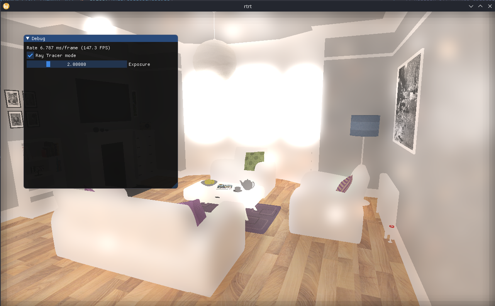

# Project 6: Denoising

## Screenshot

## Recording

(Video may not render on all markdown viewers. I use VSCode's markdown preview
to render `.md` documents, which supports this.)

<video width="1280" height="720" controls>
  <source src="media/denoise.mp4" type="video/mp4">
</video>

## Notes

- Some odd issues related to normals I think at the edges.
